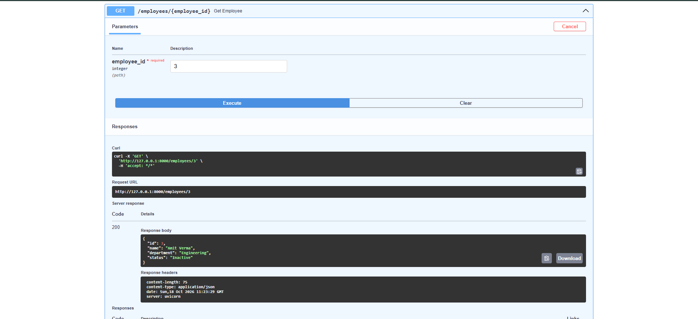
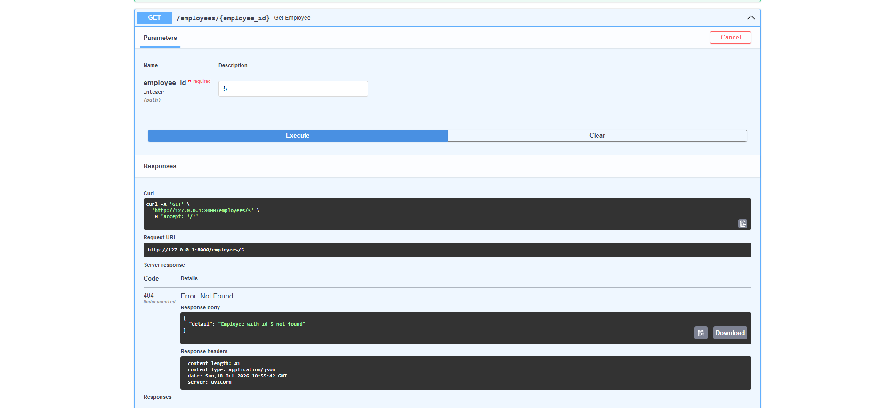
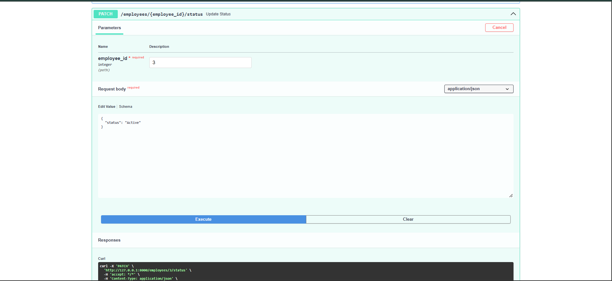
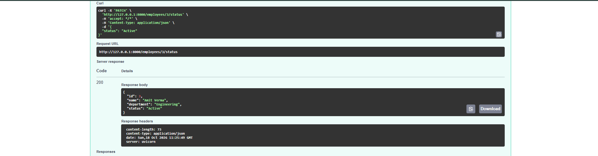

# Employee REST API (FastAPI)

Simple Employee API with in-memory storage (no database). Covers questions 1.1, 1.2 and 1.3 of the assessment.

## Run

1. Create and activate a virtual environment: (Optional but good practice)

```bash
python -m venv venv

# Windows (PowerShell / cmd)
venv\Scripts\activate

# macOS / Linux
source venv/bin/activate
```

2. Install dependencies and start the server:

```bash
pip install -r requirements.txt
uvicorn main:app --reload
```

- API: http://127.0.0.1:8000
- Swagger docs: http://127.0.0.1:8000/docs

Requires Python 3.8+. Data resets on restart (starts with the 3 sample employees).

## Endpoints

| Method | Path | Description |
|---|---|---|
| GET | `/employees` | List all employees. Optional `?department=Engineering` filter |
| GET | `/employees/{id}` | Get one employee (404 if not found) |
| POST | `/employees` | Create employee (`name`, `department`); status defaults to `Active` |
| PATCH | `/employees/{id}/status` | Set status to `Active` or `Inactive` |

Errors: `404` for unknown ID, `422` for empty name/department or an invalid status value.

A Postman collection is included: `Employee_API.postman_collection.json` (import it in Postman; base URL is the `base_url` collection variable).

## Swagger screenshots

Interactive docs: http://127.0.0.1:8000/docs

**Swagger Overview**


**GET using department filter**


**GET using ID**



**GET unknown ID; Error Response**



**POST: Create new employee**


**PATCH (updating employee status): request**



**PATCH (updating employee status): response**



All requirements in 1.1, 1.2 and 1.3 are implemented. Nothing is incomplete.
