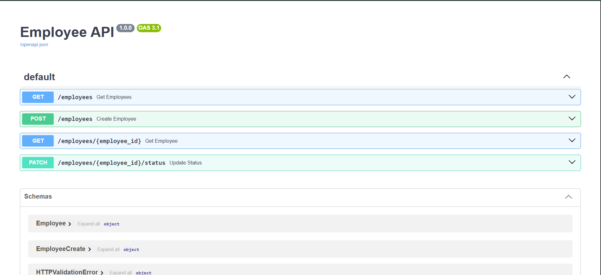
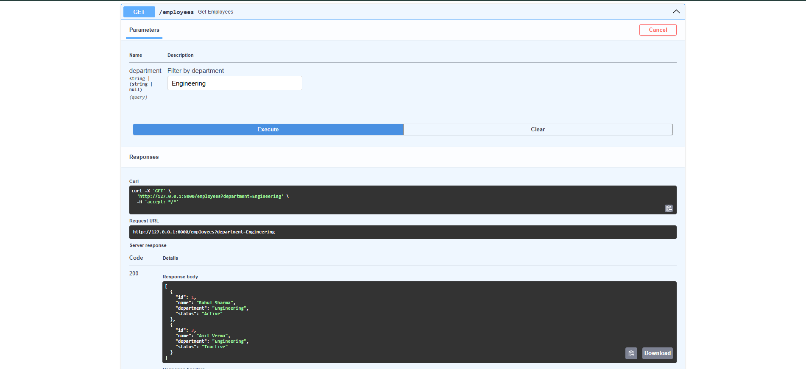
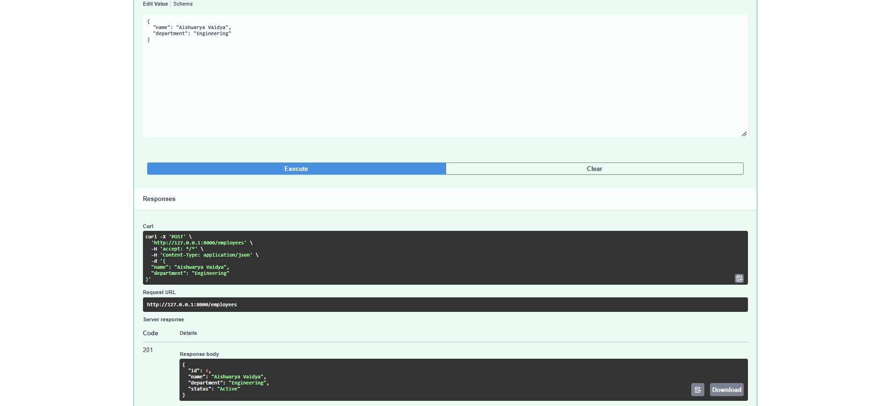

# Employee REST API (FastAPI)

Simple Employee API with in-memory storage (no database). Covers questions 1.1, 1.2 and 1.3 of the assessment.

## Run

1. Create and activate a virtual environment:

```bash
python -m venv venv

# Windows (PowerShell / cmd)
venv\Scripts\activate

# macOS / Linux
source venv/bin/activate
```

2. Install dependencies and start the server:

```bash
pip install -r requirements.txt
uvicorn main:app --reload
```

- API: http://127.0.0.1:8000
- Swagger docs: http://127.0.0.1:8000/docs

Requires Python 3.8+. Data resets on restart (starts with the 3 sample employees).

## Endpoints

| Method | Path | Description |
|---|---|---|
| GET | `/employees` | List all employees. Optional `?department=Engineering` filter |
| GET | `/employees/{id}` | Get one employee (404 if not found) |
| POST | `/employees` | Create employee (`name`, `department`); status defaults to `Active` |
| PATCH | `/employees/{id}/status` | Set status to `Active` or `Inactive` |

Errors: `404` for unknown ID, `422` for empty name/department or an invalid status value.

A Postman collection is included: `Employee_API.postman_collection.json` (import it in Postman; base URL is the `base_url` collection variable).

## Example requests and responses

**GET all**
```bash
curl http://127.0.0.1:8000/employees
```
```json
[
  {"id": 1, "name": "Rahul Sharma", "department": "Engineering", "status": "Active"},
  {"id": 2, "name": "Priya Patel", "department": "HR", "status": "Active"},
  {"id": 3, "name": "Amit Verma", "department": "Engineering", "status": "Inactive"}
]
```

**GET by ID**
```bash
curl http://127.0.0.1:8000/employees/1
```
```json
{"id": 1, "name": "Rahul Sharma", "department": "Engineering", "status": "Active"}
```

**GET missing ID** → `404`
```bash
curl http://127.0.0.1:8000/employees/99
```
```json
{"detail": "Employee with id 99 not found"}
```

**Filter by department**
```bash
curl "http://127.0.0.1:8000/employees?department=Engineering"
```
```json
[
  {"id": 1, "name": "Rahul Sharma", "department": "Engineering", "status": "Active"},
  {"id": 3, "name": "Amit Verma", "department": "Engineering", "status": "Inactive"}
]
```

**POST create** → `201`
```bash
curl -X POST http://127.0.0.1:8000/employees \
  -H "Content-Type: application/json" \
  -d '{"name": "Neha Singh", "department": "Sales"}'
```
```json
{"id": 4, "name": "Neha Singh", "department": "Sales", "status": "Active"}
```

**POST with empty name** → `422`
```bash
curl -X POST http://127.0.0.1:8000/employees \
  -H "Content-Type: application/json" \
  -d '{"name": "  ", "department": "Sales"}'
```

**PATCH status**
```bash
curl -X PATCH http://127.0.0.1:8000/employees/2/status \
  -H "Content-Type: application/json" \
  -d '{"status": "Inactive"}'
```
```json
{"id": 2, "name": "Priya Patel", "department": "HR", "status": "Inactive"}
```

**PATCH invalid status** → `422`
```bash
curl -X PATCH http://127.0.0.1:8000/employees/2/status \
  -H "Content-Type: application/json" \
  -d '{"status": "Retired"}'
```

**PATCH unknown ID** → `404`
```bash
curl -X PATCH http://127.0.0.1:8000/employees/99/status \
  -H "Content-Type: application/json" \
  -d '{"status": "Active"}'
```

## Swagger documentation screenshots

Interactive docs are available at http://127.0.0.1:8000/docs while the API is running.
Add screenshots to the `screenshots/` folder using the file names below.

**Overview of all endpoints**



**GET /employees (with department filter)**



**POST /employees**



**PATCH /employees/{id}/status**


**Error response (404 / 422)**


## Additional good practices (beyond the stated requirements)

- **Swagger / OpenAPI docs** generated automatically at `/docs` (and ReDoc at `/redoc`).
- **Postman collection** (`Employee_API.postman_collection.json`) with success and error cases.
- **Proper HTTP status codes:** `201 Created` for POST, `404` for unknown IDs, `422` for invalid input.
- **Whitespace-only input rejected:** a name or department like `"   "` is treated as empty. Values are also trimmed before saving.
- **Case-insensitive department filter:** `?department=engineering` matches `Engineering`.
- **Status as an Enum:** only `Active` or `Inactive` are accepted, enforced by the type, so no manual checks are needed.
- **Separate request and response models:** `EmployeeCreate`, `StatusUpdate` and `Employee`, so clients cannot set the ID or status when creating an employee.
- **Typed response models** keep the output consistent and documented in Swagger.
- **Clear error messages**, e.g. `Employee with id 99 not found`.
- **Single lookup helper** (`find_employee`) shared by the GET and PATCH endpoints to avoid duplicated code.
- **Virtual environment and `.gitignore`** so dependencies and cache files are not committed.

## Status

All requirements in 1.1, 1.2 and 1.3 are implemented. Nothing is incomplete.
